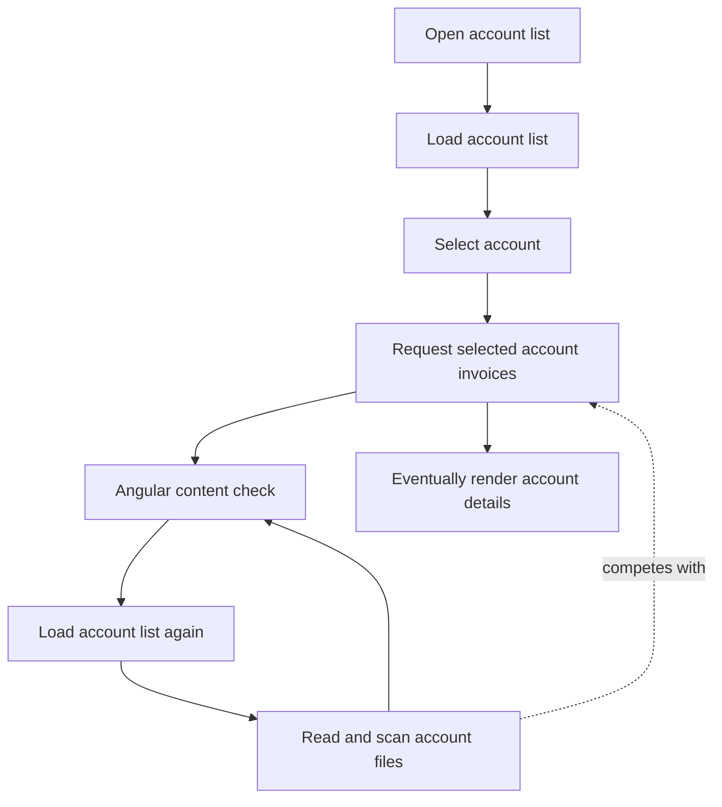
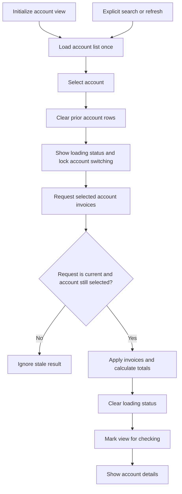

# MarketInvoiceApp

MarketInvoiceApp is an Angular application that can run in a browser for UI development or in Electron for testing local CSV storage.

## Test on macOS with Electron

1. Install Node.js 22.12 or later and npm.
2. In Terminal, go to the project folder and install dependencies:

   ```bash
   cd "/path/to/MarketInvoiceApp"
   npm install
   ```

3. Build the Angular app and launch it in Electron:

   ```bash
   npm run electron
   ```

   The first launch may take a little longer while Electron starts.
4. In the app, create an account and add invoice details. Close the app, launch it again with `npm run electron`, and confirm the account and invoice details are still present.
5. Check the CSV files in Finder at:

   ```text
   ~/Documents/MarketInvoiceApp/accounts/
   ```

   Each account has its own folder containing `account.csv`. The app creates the folders when data is first saved; you do not need to create them manually. The app's general invoice CSV, if used, is `~/Documents/MarketInvoiceApp/invoices.csv`.

To test only the Angular UI in a browser, use `npm start` and open `http://localhost:4200/`. Browser mode uses browser storage and does not test Electron's CSV-file persistence.

## Where app data is stored

CSV files are stored on the device, in a `MarketInvoiceApp` folder inside the operating system's Documents directory:

- macOS: `~/Documents/MarketInvoiceApp/`
- Windows: `%USERPROFILE%\Documents\MarketInvoiceApp\` (the Documents location may be redirected to OneDrive or another managed location)

The `accounts` subfolder contains one folder per account, with its `account.csv`. Back up this `MarketInvoiceApp` folder to preserve the data. Do not store the only copy in the installation folder, because that folder may be replaced during an update.

## Build a Windows installer

### Build it with GitHub Actions

The repository includes a manually triggered Windows build. After committing and pushing the packaging setup and `.github/workflows/build-windows.yml` to GitHub:

1. Open the repository on GitHub and select **Actions**.
2. Select **Build Windows installer** in the workflow list.
3. Select **Run workflow**, choose the branch containing the workflow, and confirm **Run workflow**.
4. Wait for the run to complete successfully, open the run, and download the `market-invoice-windows-installer` artifact from **Artifacts**.
5. Extract the downloaded ZIP to get the installer `.exe`.

The artifact is retained by GitHub for 14 days. Anyone who can access the repository’s Actions artifacts may be able to download it; use a private repository or another trusted distribution method if the installer should not be public.

### Build it directly on Windows

Alternatively, build the installer on a Windows machine:

1. Install Node.js 22.12 or later and npm on the Windows build machine.
2. Clone or copy the project to that machine, open a terminal in the project folder, and install the locked dependencies:

   ```bash
   npm ci
   ```

3. Build the Windows installer:

   ```bash
   npm run dist:win
   ```

4. Find the installer `.exe` in the generated `release/` folder. Install and test it on a Windows machine before distributing it.

The installer allows the user to choose its installation folder. App CSV data remains separate in `%USERPROFILE%\Documents\MarketInvoiceApp\` (or the system's redirected Documents location), so back up that folder separately from the installer.

The installer is not code-signed by default, so Windows may show a publisher warning until you configure a signing certificate.

## Install and use the app on Windows

1. Run the provided installer `.exe`. If Windows displays a publisher or security warning, verify the download with the person who provided it before continuing.
2. Complete the installer, then launch Market Invoice App from the Start menu or its desktop shortcut.
3. To find or back up CSV files, open File Explorer and enter `%USERPROFILE%\Documents\MarketInvoiceApp\accounts`. If Documents is redirected to OneDrive or another managed location, find the `MarketInvoiceApp` folder under that actual Documents location.
4. Before reinstalling Windows or moving to another computer, close the app and back up the entire `MarketInvoiceApp` folder. Restore it to the Documents location on the new computer before launching the app.

## Other development commands

```bash
npm start  # Run Angular in a browser at http://localhost:4200/
npm run build
npm test
```

For more information about Angular CLI, see the [Angular CLI documentation](https://angular.dev/tools/cli).


# Account Loading: Before and After

## Before

Opening an account could trigger account-list reads during every Angular content
check, including checks caused by the invoice request. In Electron, each list
read scans the account files, competing with the request needed to display the
selected account.



## After

The account list loads on initialization or an explicit search/refresh. Selecting
an account starts one invoice request. While it is pending, account switching is
locked; the response is applied only if it still belongs to the selected
account and latest request.



Writes also capture the account ID at operation start and keep the UI locked
until the save finishes, so later asynchronous steps cannot switch to a newly
selected account.
